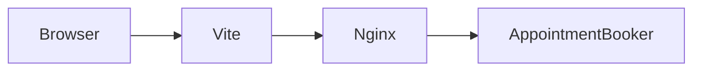

# Booking SaaS

Đặt lịch hẹn multi-tenant cho spa, salon và phòng khám. API Laravel, SPA React.

## Chạy local

```bash
docker compose up -d
```

| Việc | URL |
|---|---|
| SPA | http://localhost:5173 |
| Health | http://localhost:8080/api/v1/health |
| Mailpit | http://localhost:8025 |

Đăng ký owner tại http://localhost:5173/register. Wizard khách tại http://localhost:5173/t/{slug}.

Dữ liệu demo (slug `demo`, owner `demo@example.com` / `password`):

```bash
docker compose exec -T app php artisan db:seed --class=DemoTenantSeeder
```

`DatabaseSeeder` chỉ tạo permission. Seeder demo không chạy cùng migrate test.

## Đường đi một lần đặt lịch



Browser gọi SPA trên Vite. Vite proxy `/api` và `/sanctum` tới Nginx. Nginx chuyển vào Laravel. `AppointmentBooker` là chỗ duy nhất tạo hoặc đổi giờ.

## Quy ước

- JSON dùng `public_id` ULID. Khóa nội bộ là bigint và không ra API.
- Thời điểm lưu UTC. Giờ mở cửa và giờ làm là đồng hồ local, đọc theo timezone của chi nhánh. Mặc định `Asia/Ho_Chi_Minh`.
- Giá là số nguyên VND.
- Tenant trên URL là `/t/{slug}`. Khách đặt lịch không có dòng `users`.
