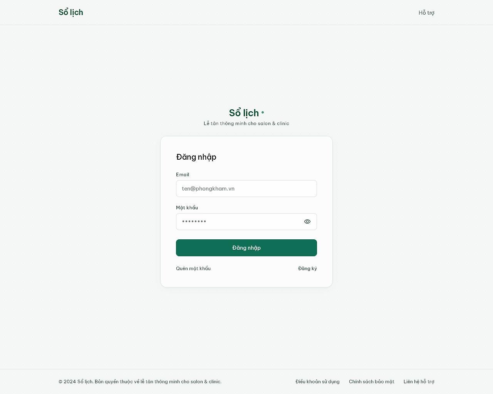
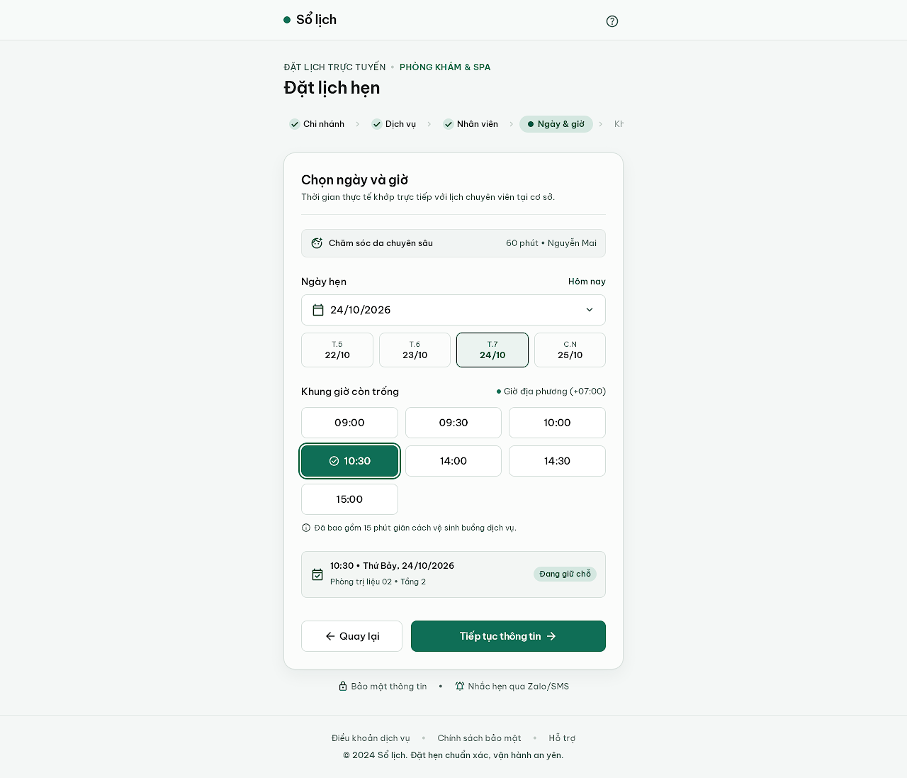
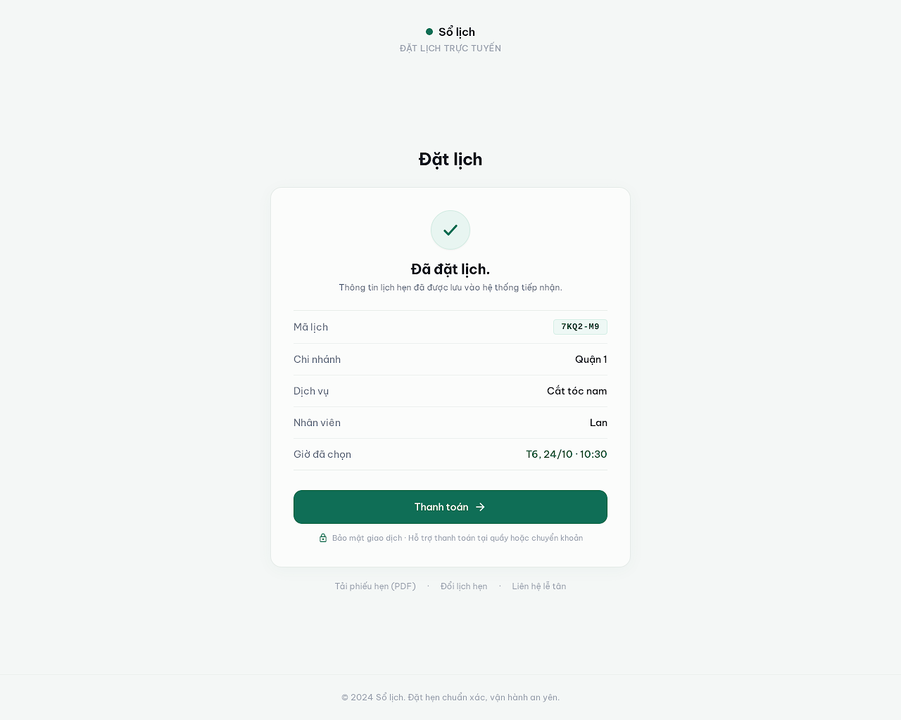
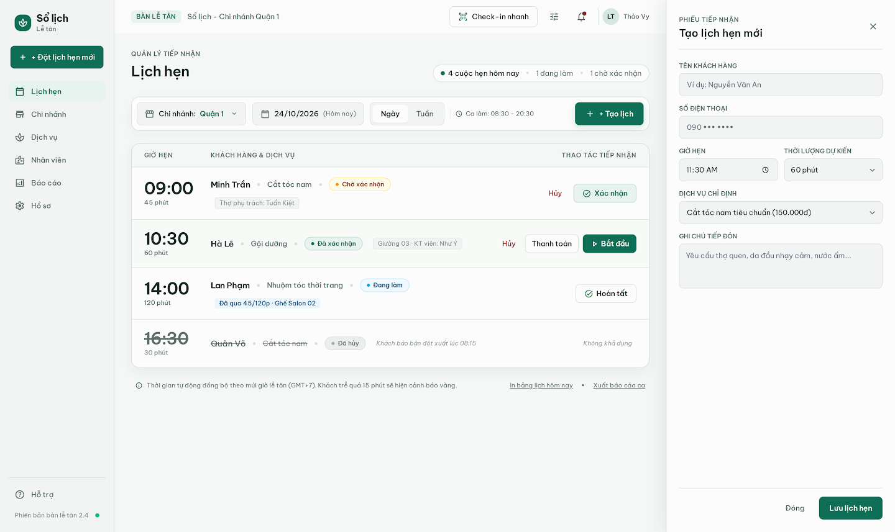
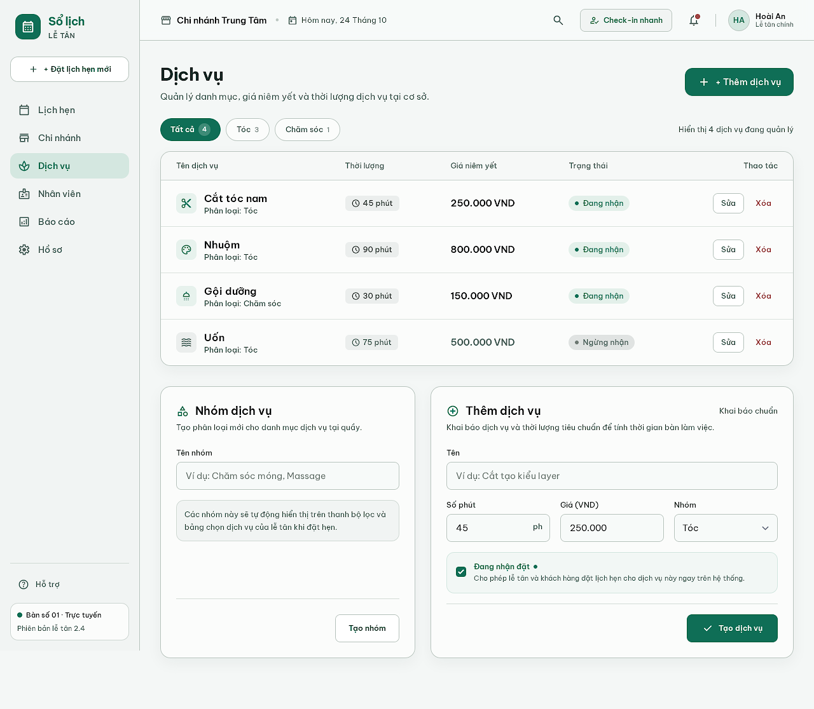
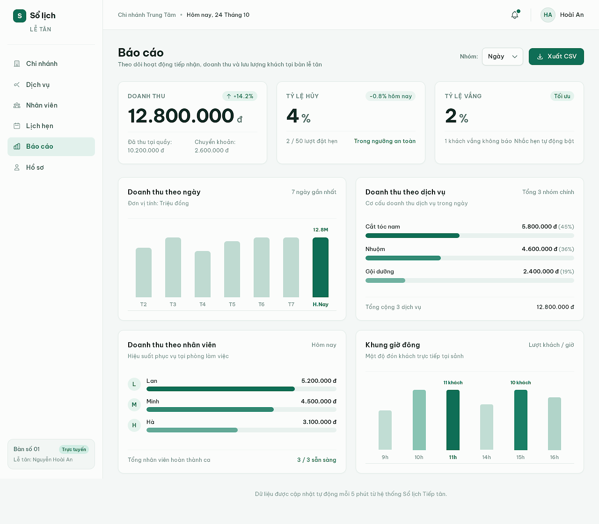
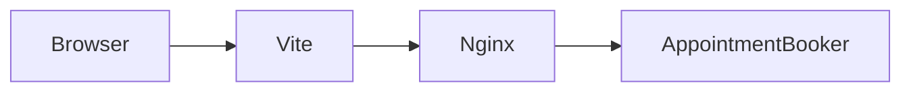

# Sổ lịch

Đặt lịch hẹn cho nhiều cơ sở spa, salon và phòng khám trên cùng một hệ thống. Mỗi cơ sở là một tenant, khách đặt lịch qua đường dẫn riêng và không cần tài khoản. Quầy lễ tân quản lý chi nhánh, dịch vụ, nhân viên, lịch hẹn, thanh toán và báo cáo.

API là Laravel 13. Giao diện là React 19, Vite và TypeScript. Dữ liệu nằm trên MySQL 8, hàng đợi và cache dùng Redis. Toàn bộ chạy bằng Docker Compose.

## Giao diện

Các ảnh dưới đây là bố cục thiết kế trên Stitch, dự án **Sổ lịch — Booking SaaS**. Ứng dụng đang chạy theo cùng các màn này: đăng nhập, đặt lịch khách, lịch hẹn, dịch vụ và báo cáo.

### Đăng nhập quầy



### Khách chọn ngày và giờ

Khách mở `/t/{slug}`, chọn chi nhánh, dịch vụ, nhân viên rồi một khung giờ. Không cần tạo tài khoản.



### Đặt lịch xong



### Lịch hẹn trong ngày



### Dịch vụ



### Báo cáo



## Chạy local

Cần Docker Engine và Compose v2. Không cần cài PHP hay Node trên máy.

```bash
cp api/.env.example api/.env
docker compose up -d --build
docker compose exec -T app php artisan key:generate
docker compose exec -T app php artisan migrate --force
docker compose exec -T app php artisan db:seed --class=DemoTenantSeeder
```

`key:generate` chỉ chạy lần đầu, khi `APP_KEY` trong `api/.env` còn trống. Seeder demo chỉ chạy một lần: nếu slug `demo` đã có, lệnh sẽ dừng.

| Việc | URL |
|---|---|
| Giao diện | http://localhost:5173 |
| Đặt lịch khách demo | http://localhost:5173/t/demo |
| Đăng nhập quầy | http://localhost:5173/login |
| Health API | http://localhost:8080/api/v1/health |
| Hộp thư (Mailpit) | http://localhost:8025 |
| MySQL từ máy host | `127.0.0.1:3307` |
| Redis | `127.0.0.1:6379` |

Vite trong container proxy `/api` và `/sanctum` sang Nginx. Nginx chuyển vào PHP. Horizon chạy ở service `queue`, lịch nhắc chạy ở service `scheduler`.

## Tài khoản demo

| Vai trò | Email | Mật khẩu | Ghi chú |
|---|---|---|---|
| Chủ cơ sở | `demo@example.com` | `password` | Seeder đánh dấu email đã xác thực |
| Nhân viên | `staff@example.com` | `password` | Chỉ xử lý lịch. Seeder chưa xác thực email, nên lần đầu sẽ vào màn xác thực |
| Khách | không có | không có | Vào `/t/demo` |

Email `demo@example.com` là địa chỉ giả. Thư xác thực, nhắc lịch và danh sách chờ vào Mailpit, không ra hộp thư thật. Nếu tài khoản demo được tạo trước khi seeder ghi `email_verified_at`, quầy sẽ hỏi xác thực: bấm **Gửi lại email xác thực**, mở link trong Mailpit, rồi đăng nhập lại.

Đăng ký cơ sở mới tại http://localhost:5173/register. Slug trở thành đường dẫn khách `/t/{slug}`.

## Việc thường gặp

Khách đặt lịch: tên và số điện thoại là bắt buộc, email có thể để trống. Một lịch gồm một nhân viên và các dịch vụ làm nối tiếp nhau, trên lưới 15 phút. Giờ lưu UTC, hiển thị theo `Asia/Ho_Chi_Minh`.

Quầy đổi **Ngày** và **Tuần**, tạo lịch hộ khách, chuyển trạng thái và bấm **Thanh toán** khi cần link checkout. **Báo cáo** đọc doanh thu đã thu, trừ phần hoàn, rồi **Xuất CSV**.

Stripe chạy ở test mode. Webhook là `POST /api/v1/stripe/webhook`.

## Kiểm tra

```bash
docker compose exec -T -e DB_CONNECTION=mysql -e DB_HOST=mysql -e DB_PORT=3306 \
  -e DB_DATABASE=booking_test -e DB_USERNAME=booking-saas -e DB_PASSWORD=booking-password \
  app php artisan test

docker compose exec -T web npm test
docker compose exec -T web npm run lint
docker compose exec -T web npm run build
```

`DatabaseSeeder` chỉ tạo permission. Seeder demo không chạy trong lúc test. Test trùng giờ cần MySQL; driver khác thì các test đó tự bỏ qua.

## Đường đi một lần đặt lịch



Trình duyệt gọi SPA trên Vite. Vite chuyển API sang Nginx, Nginx vào Laravel. `AppointmentBooker` là chỗ duy nhất tạo hoặc đổi giờ.

## Quy ước

- JSON dùng `public_id` ULID. Khóa nội bộ là bigint và không ra API.
- Thời điểm lưu UTC. Giờ mở cửa và giờ làm là đồng hồ local của chi nhánh.
- Giá là số nguyên VND.
- Tenant trên URL là `/t/{slug}`. Khách đặt lịch không tạo dòng `users`.
- Mỗi query theo tenant đi qua `TenantContext`. Thiếu ngữ cảnh thì scope ném lỗi, trừ bước tải user của phiên đăng nhập.

Chi tiết kế hoạch nằm ở [docs/PLAN.md](docs/PLAN.md). Các bước dựng máy lần đầu nằm ở [docs/SETUP.md](docs/SETUP.md).
